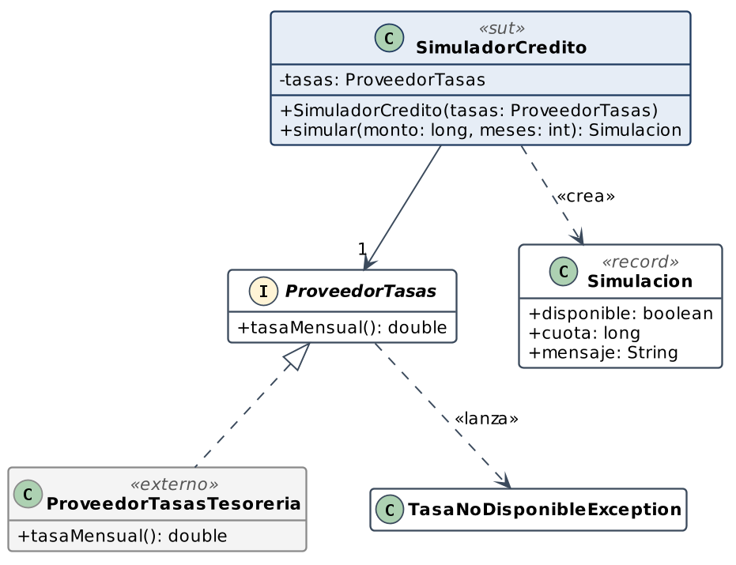

# Caso 01. Simulador de cuota de crédito

**Dominio:** Banca digital · **Tiempo sugerido:** 5 minutos · **Clase bajo prueba:** `SimuladorCredito`

## Contexto

Una cooperativa ofrece en su aplicación un simulador de crédito de libre inversión. La tasa de interés mensual no es fija: la publica cada mañana el área de tesorería a través de un servicio interno. Si ese servicio no responde, el simulador no debe fallar: muestra un mensaje y no calcula la cuota.

## Lo que el equipo necesita probar

1. Con una tasa mensual de 1,5 %, un crédito de $10.000.000 a 12 meses tiene una cuota de $916.800 (redondeada a la centena).
2. Si el servicio de tasas no responde, `simular` devuelve una simulación no disponible con el mensaje «Tasa no disponible».
3. Un plazo menor a 6 meses se rechaza con `IllegalArgumentException`.

**Condiciones de la prueba:**

- La prueba no puede depender de la tasa real del día.
- La prueba no puede conectarse al servicio interno de tesorería.

## Diagrama de clases



> La clase bajo prueba aparece resaltada en azul. Fuente editable: [`diagrama.puml`](diagrama.puml).

## Código

**[`ProveedorTasas.java`](../../src/main/java/edu/ingsoft/taller/dobles/caso01/ProveedorTasas.java)**

```java
public interface ProveedorTasas {
    /** Tasa de interés mensual (0.015 = 1,5 %). */
    double tasaMensual();
}
```

**[`TasaNoDisponibleException.java`](../../src/main/java/edu/ingsoft/taller/dobles/caso01/TasaNoDisponibleException.java)**

```java
public class TasaNoDisponibleException extends RuntimeException {
    private static final long serialVersionUID = 1L;

    public TasaNoDisponibleException(String mensaje) {
        super(mensaje);
    }
}
```

**[`Simulacion.java`](../../src/main/java/edu/ingsoft/taller/dobles/caso01/Simulacion.java)**

```java
public record Simulacion(boolean disponible, long cuota, String mensaje) {
}
```

**[`ProveedorTasasTesoreria.java`](../../src/main/java/edu/ingsoft/taller/dobles/caso01/ProveedorTasasTesoreria.java)**

```java
/** Consulta el servicio interno de tesorería (HTTP). */
public class ProveedorTasasTesoreria implements ProveedorTasas {
    @Override
    public double tasaMensual() {
        throw new TasaNoDisponibleException("Sin conexión con tesorería");
    }
}
```

**[`SimuladorCredito.java`](../../src/main/java/edu/ingsoft/taller/dobles/caso01/SimuladorCredito.java)**

```java
public class SimuladorCredito {
    private final ProveedorTasas tasas;

    public SimuladorCredito(ProveedorTasas tasas) {
        this.tasas = tasas;
    }

    public Simulacion simular(long monto, int meses) {
        if (meses < 6) {
            throw new IllegalArgumentException("El plazo mínimo es de 6 meses");
        }
        double i;
        try {
            i = tasas.tasaMensual();
        } catch (TasaNoDisponibleException e) {
            return new Simulacion(false, 0, "Tasa no disponible");
        }
        double cuota = monto * i / (1 - Math.pow(1 + i, -meses));
        return new Simulacion(true, Math.round(cuota / 100) * 100, "OK");
    }
}
```

## Preguntas

1. ¿De qué colaboradores depende la clase bajo prueba? ¿Cómo los obtiene (constructor, `new`, llamada estática, reloj del sistema…)?
2. ¿Existen costuras que permitan sustituir cada colaborador en la prueba? Si existen, ¿cuál es su punto de habilitación?
3. Para cada escenario de prueba, ¿qué tipo de doble de prueba (dummy, stub, spy, mock o fake) necesita cada colaborador y por qué?
4. ¿Es necesario refactorizar o aplicar algún patrón de diseño para poder escribir las pruebas? ¿Cuál y por qué?

> **Pista:** Observe cómo obtiene la clase la tasa de interés antes de pensar en refactorizar.

## Respuesta

Diligencie [`RESPUESTA.md`](RESPUESTA.md) en esta misma carpeta.

[← Volver a la actividad](../../README.md)
