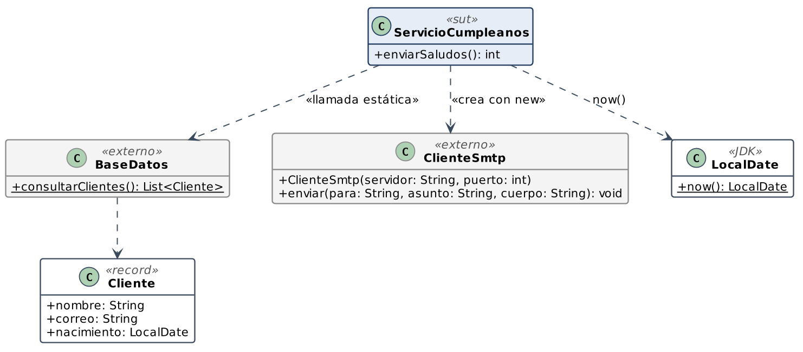

# Caso 02. Saludos de cumpleaños a clientes

**Dominio:** Comercio minorista (CRM) · **Tiempo sugerido:** 7 minutos · **Clase bajo prueba:** `ServicioCumpleanos`

## Contexto

Una cadena de almacenes envía cada mañana un correo de felicitación con un cupón del 15 % a los clientes que cumplen años ese día. Un proceso programado ejecuta `ServicioCumpleanos.enviarSaludos()` a las 7:00 a. m. Los clientes se leen de la base de datos con una clase de utilidades que el equipo usa en todo el sistema.

## Lo que el equipo necesita probar

1. Si hoy es 20 de noviembre y dos de tres clientes cumplen años ese día, se envían exactamente dos correos, a los clientes correctos.
2. El correo incluye el nombre del cliente y el código de cupón «CUMPLE15».
3. Un cliente nacido el 29 de febrero recibe el saludo el 28 de febrero en los años no bisiestos.

**Condiciones de la prueba:**

- La prueba debe poder ejecutarse cualquier día del año con el mismo resultado.
- La prueba no puede enviar correos reales ni requerir una base de datos.

## Diagrama de clases



> La clase bajo prueba aparece resaltada en azul. Fuente editable: [`diagrama.puml`](diagrama.puml).

## Código

**[`Cliente.java`](../../src/main/java/edu/ingsoft/taller/dobles/caso02/Cliente.java)**

```java
import java.time.LocalDate;

public record Cliente(String nombre, String correo, LocalDate nacimiento) {
}
```

**[`BaseDatos.java`](../../src/main/java/edu/ingsoft/taller/dobles/caso02/BaseDatos.java)**

```java
import java.util.List;

/** Utilidad usada en todo el sistema para consultar la base de datos de producción. */
public final class BaseDatos {
    private BaseDatos() {
    }

    public static List<Cliente> consultarClientes() {
        throw new IllegalStateException("Requiere conexión a la base de datos de producción");
    }
}
```

**[`ClienteSmtp.java`](../../src/main/java/edu/ingsoft/taller/dobles/caso02/ClienteSmtp.java)**

```java
/** Cliente del servidor de correo corporativo. */
public class ClienteSmtp {
    private final String servidor;

    public ClienteSmtp(String servidor, int puerto) {
        this.servidor = servidor + ":" + puerto; // abre la conexión
    }

    public void enviar(String para, String asunto, String cuerpo) {
        System.out.println("[" + servidor + "] -> " + para + ": " + asunto);
    }
}
```

**[`ServicioCumpleanos.java`](../../src/main/java/edu/ingsoft/taller/dobles/caso02/ServicioCumpleanos.java)**

```java
import java.time.LocalDate;
import java.time.MonthDay;

public class ServicioCumpleanos {

    /** Envía el saludo a quienes cumplen años hoy; devuelve cuántos correos envió. */
    public int enviarSaludos() {
        LocalDate hoy = LocalDate.now();
        ClienteSmtp smtp = new ClienteSmtp("smtp.almacenes.co", 587);
        int enviados = 0;
        for (Cliente c : BaseDatos.consultarClientes()) {
            if (cumpleHoy(c.nacimiento(), hoy)) {
                smtp.enviar(c.correo(), "¡Feliz cumpleaños, " + c.nombre() + "!",
                        "Celébralo con 15 % de descuento usando el cupón CUMPLE15.");
                enviados++;
            }
        }
        return enviados;
    }

    private boolean cumpleHoy(LocalDate nacimiento, LocalDate hoy) {
        MonthDay cumple = MonthDay.from(nacimiento);
        if (cumple.equals(MonthDay.of(2, 29)) && !hoy.isLeapYear()) {
            cumple = MonthDay.of(2, 28);
        }
        return cumple.equals(MonthDay.from(hoy));
    }
}
```

## Preguntas

1. ¿De qué colaboradores depende la clase bajo prueba? ¿Cómo los obtiene (constructor, `new`, llamada estática, reloj del sistema…)?
2. ¿Existen costuras que permitan sustituir cada colaborador en la prueba? Si existen, ¿cuál es su punto de habilitación?
3. Para cada escenario de prueba, ¿qué tipo de doble de prueba (dummy, stub, spy, mock o fake) necesita cada colaborador y por qué?
4. ¿Es necesario refactorizar o aplicar algún patrón de diseño para poder escribir las pruebas? ¿Cuál y por qué?

## Respuesta

Diligencie [`RESPUESTA.md`](RESPUESTA.md) en esta misma carpeta.

[← Volver a la actividad](../../README.md)
