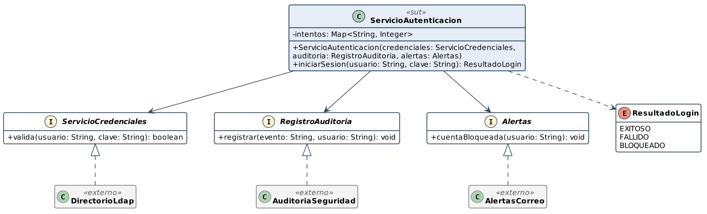

# Caso 03. Bloqueo de cuentas por intentos fallidos

**Dominio:** Seguridad de aplicaciones · **Tiempo sugerido:** 6 minutos · **Clase bajo prueba:** `ServicioAutenticacion`

## Contexto

El portal académico bloquea una cuenta después de tres intentos fallidos de inicio de sesión. Cada intento fallido debe quedar registrado en el sistema de auditoría de seguridad (exigido por la oficina de control interno), y al bloquear la cuenta se envía una alerta al correo del usuario. La validación de la contraseña la hace un servicio de credenciales.

## Lo que el equipo necesita probar

1. Con una contraseña incorrecta, se registra exactamente un evento «LOGIN_FALLIDO» con el usuario en la auditoría y no se envía alerta.
2. Al tercer intento fallido, la cuenta queda bloqueada y se envía una única alerta al usuario.
3. Un usuario vacío se rechaza con `IllegalArgumentException` sin consultar ningún colaborador.

**Condiciones de la prueba:**

- La prueba no puede escribir en la auditoría real ni enviar correos.
- Las credenciales de prueba no existen en el directorio institucional.

## Diagrama de clases



> La clase bajo prueba aparece resaltada en azul. Fuente editable: [`diagrama.puml`](diagrama.puml).

## Código

**[`ResultadoLogin.java`](../../src/main/java/edu/ingsoft/taller/dobles/caso03/ResultadoLogin.java)**

```java
public enum ResultadoLogin {
    EXITOSO, FALLIDO, BLOQUEADO
}
```

**[`ServicioCredenciales.java`](../../src/main/java/edu/ingsoft/taller/dobles/caso03/ServicioCredenciales.java)**

```java
public interface ServicioCredenciales {
    boolean valida(String usuario, String clave);
}
```

**[`RegistroAuditoria.java`](../../src/main/java/edu/ingsoft/taller/dobles/caso03/RegistroAuditoria.java)**

```java
public interface RegistroAuditoria {
    void registrar(String evento, String usuario);
}
```

**[`Alertas.java`](../../src/main/java/edu/ingsoft/taller/dobles/caso03/Alertas.java)**

```java
public interface Alertas {
    void cuentaBloqueada(String usuario);
}
```

**[`ServicioAutenticacion.java`](../../src/main/java/edu/ingsoft/taller/dobles/caso03/ServicioAutenticacion.java)**

```java
import java.util.HashMap;
import java.util.Map;

public class ServicioAutenticacion {
    static final int MAX_INTENTOS = 3;
    private final ServicioCredenciales credenciales;
    private final RegistroAuditoria auditoria;
    private final Alertas alertas;
    private final Map<String, Integer> intentos = new HashMap<>();

    public ServicioAutenticacion(ServicioCredenciales credenciales, RegistroAuditoria auditoria,
                                 Alertas alertas) {
        this.credenciales = credenciales;
        this.auditoria = auditoria;
        this.alertas = alertas;
    }

    public ResultadoLogin iniciarSesion(String usuario, String clave) {
        if (usuario == null || usuario.isBlank()) {
            throw new IllegalArgumentException("Usuario requerido");
        }
        if (intentos.getOrDefault(usuario, 0) >= MAX_INTENTOS) {
            return ResultadoLogin.BLOQUEADO;
        }
        if (credenciales.valida(usuario, clave)) {
            intentos.remove(usuario);
            return ResultadoLogin.EXITOSO;
        }
        auditoria.registrar("LOGIN_FALLIDO", usuario);
        int n = intentos.merge(usuario, 1, Integer::sum);
        if (n == MAX_INTENTOS) {
            alertas.cuentaBloqueada(usuario);
            return ResultadoLogin.BLOQUEADO;
        }
        return ResultadoLogin.FALLIDO;
    }
}
```

## Preguntas

1. ¿De qué colaboradores depende la clase bajo prueba? ¿Cómo los obtiene (constructor, `new`, llamada estática, reloj del sistema…)?
2. ¿Existen costuras que permitan sustituir cada colaborador en la prueba? Si existen, ¿cuál es su punto de habilitación?
3. Para cada escenario de prueba, ¿qué tipo de doble de prueba (dummy, stub, spy, mock o fake) necesita cada colaborador y por qué?
4. ¿Es necesario refactorizar o aplicar algún patrón de diseño para poder escribir las pruebas? ¿Cuál y por qué?

## Respuesta

Diligencie [`RESPUESTA.md`](RESPUESTA.md) en esta misma carpeta.

[← Volver a la actividad](../../README.md)
