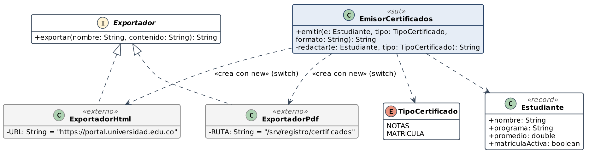

# Caso 04. Emisión de certificados académicos

**Dominio:** Gestión universitaria · **Tiempo sugerido:** 6 minutos · **Clase bajo prueba:** `EmisorCertificados`

## Contexto

La oficina de registro emite certificados de notas y de matrícula. Según lo que pida el estudiante, el certificado se genera en PDF (se guarda en el servidor de archivos de la universidad) o en HTML (se envía al portal). El texto del certificado incluye el nombre, el programa y el promedio acumulado con un decimal.

## Lo que el equipo necesita probar

1. Un certificado de notas para «Ana Ruiz», de Ingeniería de Sistemas, con promedio 4,26, contiene el texto «promedio acumulado de 4,3».
2. Un estudiante con matrícula cancelada no recibe certificado de matrícula: se lanza `IllegalStateException` y no se genera ningún archivo.
3. Al pedir formato HTML se usa el exportador HTML y no el PDF.

**Condiciones de la prueba:**

- La prueba no puede escribir en el servidor de archivos de la universidad.
- La prueba debe verificar el contenido generado sin abrir un PDF.

## Diagrama de clases



> La clase bajo prueba aparece resaltada en azul. Fuente editable: [`diagrama.puml`](diagrama.puml).

## Código

**[`Estudiante.java`](../../src/main/java/edu/ingsoft/taller/dobles/caso04/Estudiante.java)**

```java
public record Estudiante(String nombre, String programa, double promedio,
                         boolean matriculaActiva) {
}
```

**[`TipoCertificado.java`](../../src/main/java/edu/ingsoft/taller/dobles/caso04/TipoCertificado.java)**

```java
public enum TipoCertificado {
    NOTAS, MATRICULA
}
```

**[`Exportador.java`](../../src/main/java/edu/ingsoft/taller/dobles/caso04/Exportador.java)**

```java
public interface Exportador {
    /** Exporta el contenido y devuelve la ubicación del documento generado. */
    String exportar(String nombre, String contenido);
}
```

**[`ExportadorPdf.java`](../../src/main/java/edu/ingsoft/taller/dobles/caso04/ExportadorPdf.java)**

```java
public class ExportadorPdf implements Exportador {
    private static final String RUTA = "/srv/registro/certificados";

    @Override
    public String exportar(String nombre, String contenido) {
        // genera el PDF y lo escribe en el servidor de archivos
        return RUTA + "/" + nombre + ".pdf";
    }
}
```

**[`ExportadorHtml.java`](../../src/main/java/edu/ingsoft/taller/dobles/caso04/ExportadorHtml.java)**

```java
public class ExportadorHtml implements Exportador {
    private static final String URL = "https://portal.universidad.edu.co";

    @Override
    public String exportar(String nombre, String contenido) {
        // publica el HTML en el portal
        return URL + "/certificados/" + nombre;
    }
}
```

**[`EmisorCertificados.java`](../../src/main/java/edu/ingsoft/taller/dobles/caso04/EmisorCertificados.java)**

```java
import java.util.Locale;

public class EmisorCertificados {

    public String emitir(Estudiante e, TipoCertificado tipo, String formato) {
        if (tipo == TipoCertificado.MATRICULA && !e.matriculaActiva()) {
            throw new IllegalStateException("El estudiante no tiene matrícula activa");
        }
        Exportador exportador;
        switch (formato) {
            case "PDF" -> exportador = new ExportadorPdf();
            case "HTML" -> exportador = new ExportadorHtml();
            default -> throw new IllegalArgumentException("Formato no soportado: " + formato);
        }
        String nombre = tipo.name().toLowerCase() + "-" + e.nombre().replace(' ', '_');
        return exportador.exportar(nombre, redactar(e, tipo));
    }

    private String redactar(Estudiante e, TipoCertificado tipo) {
        if (tipo == TipoCertificado.NOTAS) {
            return String.format(Locale.forLanguageTag("es-CO"),
                    "Se certifica que %s, del programa %s, tiene un promedio acumulado de %.1f.",
                    e.nombre(), e.programa(), e.promedio());
        }
        return "Se certifica que " + e.nombre() + " se encuentra matriculado en " + e.programa() + ".";
    }
}
```

## Preguntas

1. ¿De qué colaboradores depende la clase bajo prueba? ¿Cómo los obtiene (constructor, `new`, llamada estática, reloj del sistema…)?
2. ¿Existen costuras que permitan sustituir cada colaborador en la prueba? Si existen, ¿cuál es su punto de habilitación?
3. Para cada escenario de prueba, ¿qué tipo de doble de prueba (dummy, stub, spy, mock o fake) necesita cada colaborador y por qué?
4. ¿Es necesario refactorizar o aplicar algún patrón de diseño para poder escribir las pruebas? ¿Cuál y por qué?

> **Pista:** Fíjese en dónde se decide qué exportador se usa y quién lo crea.

## Respuesta

Diligencie [`RESPUESTA.md`](RESPUESTA.md) en esta misma carpeta.

[← Volver a la actividad](../../README.md)
