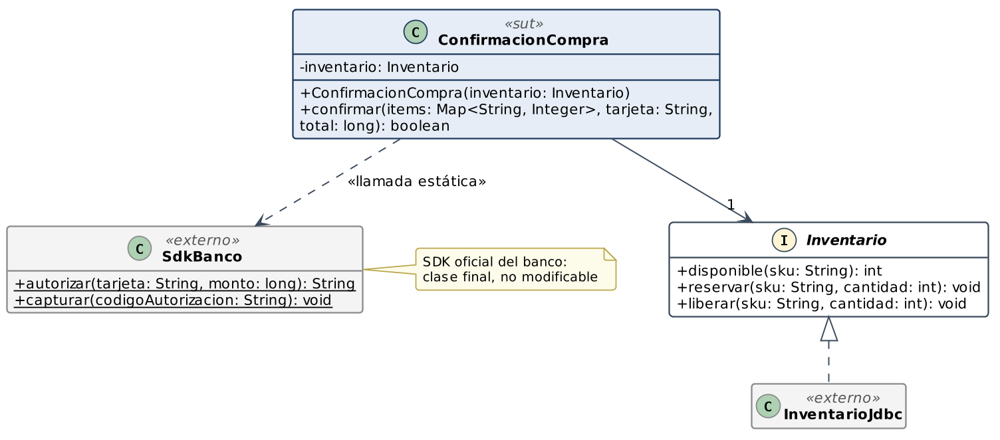

# Caso 05. Confirmación de compra en una tienda en línea

**Dominio:** Comercio electrónico · **Tiempo sugerido:** 6 minutos · **Clase bajo prueba:** `ConfirmacionCompra`

## Contexto

Al confirmar una compra, la tienda reserva cada producto en el inventario, cobra con la pasarela de pagos del banco y, si el cobro es rechazado, libera las reservas. La pasarela se usa mediante el SDK oficial del banco: una clase final con métodos estáticos que exige autorizar primero y capturar después. El inventario se consulta y modifica varias veces durante una misma compra.

## Lo que el equipo necesita probar

1. Si hay existencias y el pago se aprueba, las existencias disminuyen y el pago se autoriza y luego se captura, en ese orden.
2. Si el pago es rechazado, las existencias vuelven a su valor inicial y nunca se llama a capturar.
3. Si un producto no tiene existencias, no se intenta cobrar.

**Condiciones de la prueba:**

- La prueba no puede cobrar dinero real ni conectarse al banco.
- Cada prueba debe partir de existencias conocidas (por ejemplo, 5 unidades de «CAFE-500»).

## Diagrama de clases



> La clase bajo prueba aparece resaltada en azul. Fuente editable: [`diagrama.puml`](diagrama.puml).

## Código

**[`Inventario.java`](../../src/main/java/edu/ingsoft/taller/dobles/caso05/Inventario.java)**

```java
public interface Inventario {
    int disponible(String sku);

    void reservar(String sku, int cantidad);

    void liberar(String sku, int cantidad);
}
```

**[`SdkBanco.java`](../../src/main/java/edu/ingsoft/taller/dobles/caso05/SdkBanco.java)**

```java
/** SDK oficial del banco (no modificable). Autorizar devuelve null si se rechaza. */
public final class SdkBanco {
    private SdkBanco() {
    }

    public static String autorizar(String tarjeta, long monto) {
        throw new IllegalStateException("Conexión con el banco no disponible");
    }

    public static void capturar(String codigoAutorizacion) {
        throw new IllegalStateException("Conexión con el banco no disponible");
    }
}
```

**[`ConfirmacionCompra.java`](../../src/main/java/edu/ingsoft/taller/dobles/caso05/ConfirmacionCompra.java)**

```java
import java.util.Map;

public class ConfirmacionCompra {
    private final Inventario inventario;

    public ConfirmacionCompra(Inventario inventario) {
        this.inventario = inventario;
    }

    public boolean confirmar(Map<String, Integer> items, String tarjeta, long total) {
        for (Map.Entry<String, Integer> item : items.entrySet()) {
            if (inventario.disponible(item.getKey()) < item.getValue()) {
                return false;
            }
        }
        items.forEach(inventario::reservar);
        String autorizacion = SdkBanco.autorizar(tarjeta, total);
        if (autorizacion == null) {
            items.forEach(inventario::liberar);
            return false;
        }
        SdkBanco.capturar(autorizacion);
        return true;
    }
}
```

## Preguntas

1. ¿De qué colaboradores depende la clase bajo prueba? ¿Cómo los obtiene (constructor, `new`, llamada estática, reloj del sistema…)?
2. ¿Existen costuras que permitan sustituir cada colaborador en la prueba? Si existen, ¿cuál es su punto de habilitación?
3. Para cada escenario de prueba, ¿qué tipo de doble de prueba (dummy, stub, spy, mock o fake) necesita cada colaborador y por qué?
4. ¿Es necesario refactorizar o aplicar algún patrón de diseño para poder escribir las pruebas? ¿Cuál y por qué?

## Respuesta

Diligencie [`RESPUESTA.md`](RESPUESTA.md) en esta misma carpeta.

[← Volver a la actividad](../../README.md)
